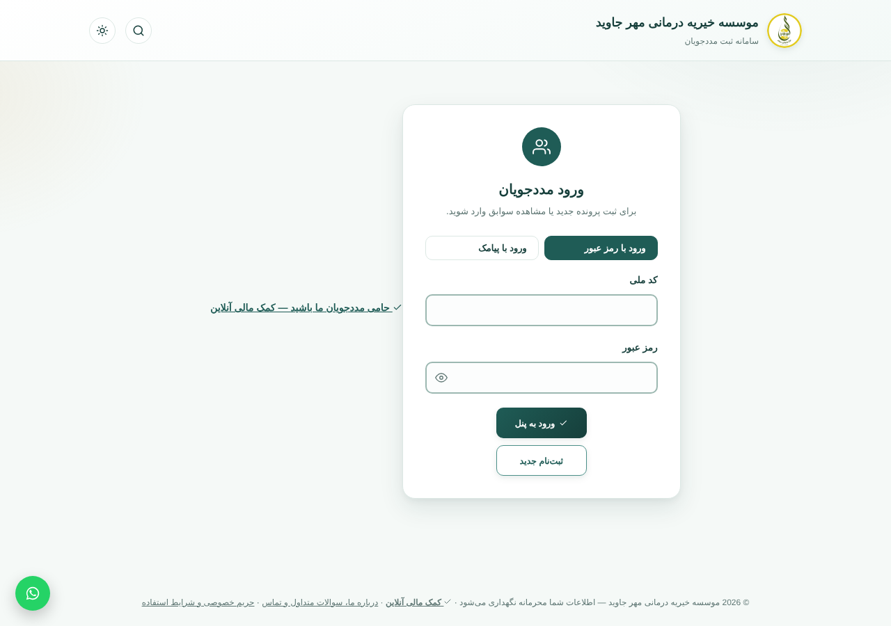
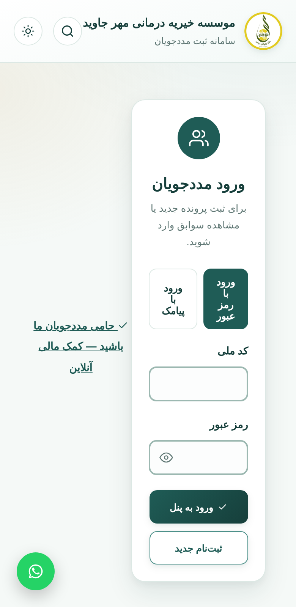
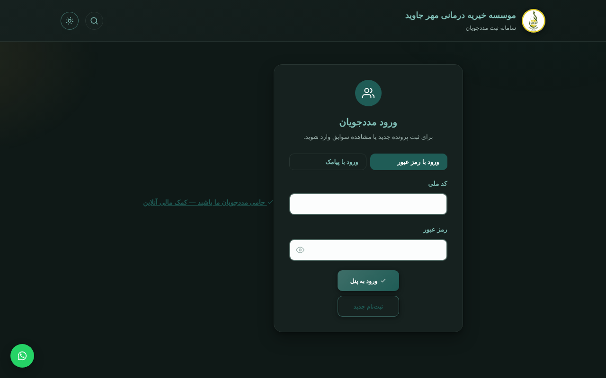

# Mehr Javid — Charity Case Management

🇬🇧 English documentation: [docs/en/README.md](docs/en/README.md)

A lightweight, Persian-language (RTL) web app for managing a medical charity: beneficiary case registration and tracking, accounting, and donor tracking.

Built for [موسسه خیریه درمانی مهر جاوید](https://mehrejaviid.ir), and designed so other small Persian-speaking charities can reuse it.

## Why

Small charities in Iran rarely have affordable software for case management and transparent accounting, and almost nothing exists as open source with proper Persian/RTL support. This project aims to fill that gap.

## Screenshots

Persian RTL, responsive, with light/dark themes.

| Desktop | Mobile | Dark |
|---|---|---|
|  |  |  |

## Features

- Beneficiary (مددجو) case registration and follow-up
- Accounting and donor tracking
- OTP login and SMS notifications (Najva)
- Admin panel
- Runs on ordinary shared hosting (cPanel / LiteSpeed)

## Tech stack

- Frontend: HTML / CSS / JavaScript (`index.html`)
- Backend: PHP + SQLite (`api.php`)

## Setup

1. Upload the files to a PHP-enabled host.
2. Copy `config.example.php` to `config.php` and fill in your settings (SMS key, optional payment merchant ID).
3. Open the site. On first run an admin account is created: username `admin`, with the password from `config.php` or an auto-generated one saved in `data/INITIAL_ADMIN_PASSWORD.txt`. You must change it at first login; then delete that file.

> No real beneficiary or donor data is included in this repository.

## Roadmap

See [ROADMAP.md](ROADMAP.md) and [CHANGELOG.md](CHANGELOG.md).

## Contributing

See [CONTRIBUTING.md](CONTRIBUTING.md). Security issues: see [SECURITY.md](SECURITY.md).

## Status

Actively maintained. Roadmap: better financial reports, tests, English docs, easier multi-charity setup.

## License

MIT — see [LICENSE](LICENSE).
